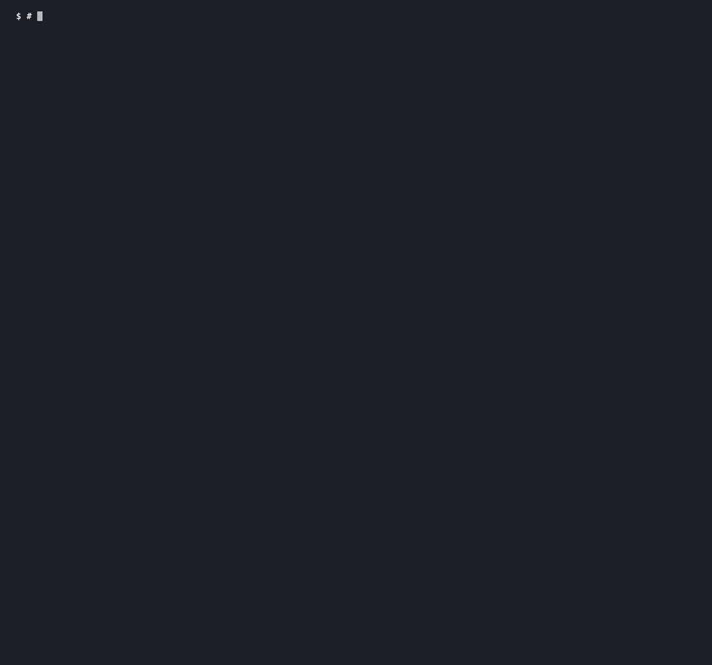
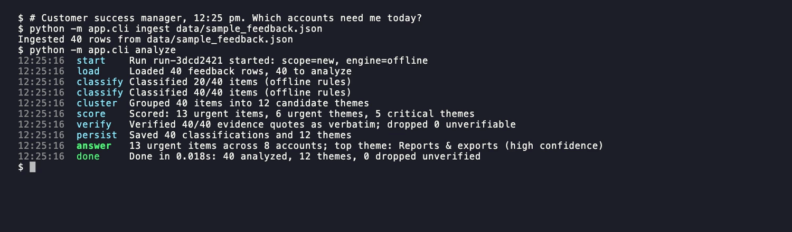
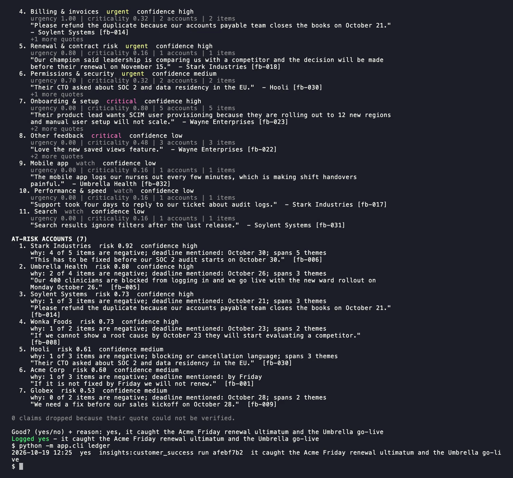
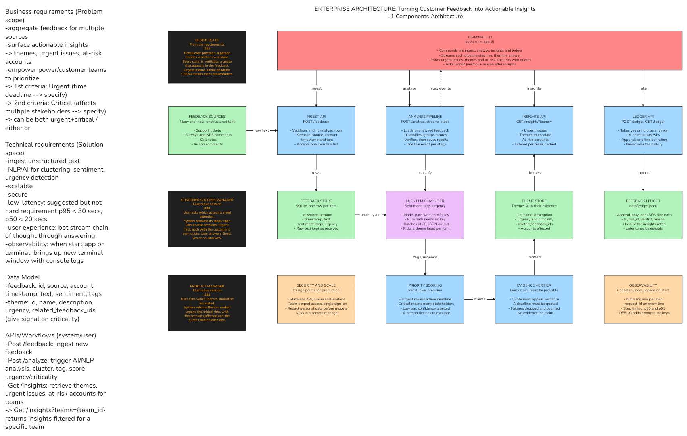

# Customer Feedback Insights

Turns customer feedback from many sources into what a team can act on, the urgent issues, the themes worth escalating and the accounts at risk, each backed by the customer's own words.

   



I built this in a 45-minute exercise for internal customer success and product teams. They collect feedback in support tickets, surveys, call notes, Slack and email, and need to know what matters today.

## Try it

You need Python 3.11 or newer on macOS or Linux. No API key and no AI assistant is needed.

```bash
git clone https://github.com/jameswniu/customer-feedback-insights
cd customer-feedback-insights
./run.sh
```

`run.sh` sets up a virtual environment, installs the dependencies, starts the API on port 8000 and, on macOS, opens a second Terminal window that follows the logs. Then use the CLI from the first window.

```bash
python -m app.cli ingest data/sample_feedback.json
python -m app.cli analyze
python -m app.cli insights --team customer_success
python -m app.cli ledger
```



`analyze` prints every step as it happens. `insights` prints the results, then asks `Good? (yes/no) + reason:` and saves your answer. `ledger` shows the saved answers, and a "no" must come with a reason.

## How it decides what matters

An item is urgent when it carries a time deadline, such as a renewal date, a launch or a blocking outage. It is critical when it affects several stakeholders, meaning several accounts or one account across sources. It can be both, either or neither, and each theme gets a label (`urgent+critical`, `urgent`, `critical` or `watch`).

Two rules shape the results. I favour recall over precision, because a person decides whether to escalate, so borderline items appear with a low confidence label instead of being hidden. And the tool never states what it cannot show. Each claim quotes the customer word for word, code checks that the quote really appears in the source text, and any claim that fails the check is dropped and counted.



## Under the hood



The CLI talks to a FastAPI service. Feedback lands in SQLite, a pipeline classifies each item, groups items into themes and scores urgency and criticality, and every quote is verified before anything is saved. The insights endpoint reads the result and filters it by team.

Without an API key a rule-based classifier does the work. With `ANTHROPIC_API_KEY` set in `.env`, a model (Claude Haiku by default) classifies in batches of 20 and any batch it cannot parse falls back to the rules. `.env.example` lists every setting, and `LLM_MODE=offline` forces the rules.

## Debugging

Every run writes JSON lines to `logs/app.log`, with a request id and step timing on each line. The second Terminal window shows the same stream.

```bash
LOG_LEVEL=DEBUG ./run.sh        # also logs model prompts and replies, never the API key
tail -f logs/app.log | jq .     # follow and pretty-print
grep 3f9a1c logs/app.log        # trace one request by its id
./scripts/debug_bundle.sh       # last 2000 log lines, versions, row counts, secrets redacted
```

## Tests

```bash
pytest -q                       # 69 tests, all offline
./scripts/smoke.sh              # the whole flow on a throwaway database
python scripts/latency.py       # median and p95 time for an analysis
```

The tests check recall on the labelled urgent items and that every quote appears in its source. They never assert precision, on purpose. `docs/evals-questions.md` lists 30 more cases, 10 everyday conversations and 20 edge cases, written for a person to read.

## How I built it

I split the 45 minutes across four AI coding sessions working from one task board (`TASKS.md`), an architect, two engineers and a QA that tried to break the claims. `CLAUDE.md` is the contract that kept them consistent, and it is enough for an agent with no memory to rebuild the repo.

SQLite and one process keep this easy to run. To productionize it I would put the API behind single sign-on with team-scoped queries and move analysis onto a queue with workers. I would also store themes in Postgres with embeddings for clustering and redact personal data before any model call. With more time I would use the saved ratings to tune thresholds and prompts.

Known limits, left alone to stay inside the 45 minutes:

- The quote check ignores case and spacing, so it proves a quote is present rather than character-exact.
- Results are saved in two writes instead of one transaction, and insights read at most 10,000 rows.
- Two analyses started at once can overwrite each other.
- The saved ratings trust the run id the CLI sends.
